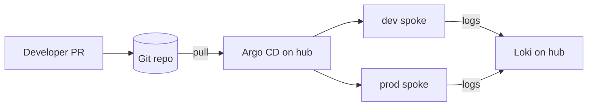

# 00 Welcome

**Goal:** know what you're building, get your tools installed, and pick a track.
**Time:** 15 minutes

**You'll touch:** [README.md](../README.md), [docs/fleet-architecture.md](../docs/fleet-architecture.md), [bootstrap/](../bootstrap/)

## Where this came from

This course started as a hands-on workshop I ran for [PlatformEngr](https://www.platformengr.com/). Attendees kept asking for the material afterwards, so it's now public. I've kept the workshop's shape: short explanations, lots of typing, and a "break it on purpose" exercise in every module, because that is where most people say things finally clicked.

I'm [Daniel Abrahamberg](https://www.abrahamberg.com/). I build Kubernetes platforms for a living, and this repo is the reference fleet I wish I'd had the first time I managed more than two clusters.

## What you'll build

By the end you have a **hub-and-spoke fleet** managed entirely from Git:

- A **hub** (platform) cluster running Argo CD, ApplicationSets, Loki and Grafana.
- Two **spokes**, `dev` and `prod`, each receiving the same platform add-ons (cert-manager, ingress-nginx, Argo Rollouts, External Secrets, metrics-server, kube-prometheus-stack, Kyverno) with environment-specific settings.
- **Tenant onboarding by pull request**: a team adds one YAML file and gets a namespace with quotas, limits, network policy and Pod Security labels in the right environments.
- **Progressive rollout**: changes reach `dev` before `prod`.
- A path to **production**: workload identity instead of static credentials, SSO, HA Argo CD, CI validation and a day-2 runbook.



## Prerequisites

Comfortable with `kubectl get/apply/describe`, basic YAML, and Git branches/PRs. You don't need prior Argo CD experience.

Tools (all tracks):

| Tool | Why | Check |
| --- | --- | --- |
| `git` | the source of truth | `git --version` |
| `kubectl` | talk to clusters | `kubectl version --client` |
| `helm` 3 | render/inspect charts | `helm version` |
| `kustomize` (or `kubectl kustomize`) | render overlays | `kubectl kustomize --help` |
| `argocd` CLI | optional but handy | `argocd version --client` |
| `yq`, `jq` | inspect YAML/JSON | `yq --version` |

Track-specific:

| Track | Extra tools | Machine |
| --- | --- | --- |
| kind | Docker (or Podman), `kind` | 4 CPU / 8 GB RAM free is comfortable for 3 clusters; 16 GB if you enable everything |
| AKS | `az` | an Azure subscription you may create resource groups in |
| EKS | `aws`, `eksctl` | an AWS account with permission to create VPCs/EKS |
| GKE | `gcloud` | a project with the GKE API enabled |

## Fork the repo

Argo CD pulls from Git, so it must point at a repo you can push to.

```bash
# fork on GitHub first, then:
git clone https://github.com/<you>/fleet-gitops.git
cd fleet-gitops
export REPO_URL=https://github.com/<you>/fleet-gitops.git
./scripts/set-repo-url.sh "$REPO_URL"   # rewrites root-app.yaml + applicationsets/*.yaml
git commit -am "Point Argo CD at my fork" && git push
```

`set-repo-url.sh` does not touch the course labs. Modules 01 and 02 show the one-line `sed` for those.

## Choose your track

- **kind (default):** everything runs on your laptop. Recommended for modules 01-09.
- **AKS / EKS / GKE:** same repo, real cloud clusters. Read module 10 before running `bootstrap/<cloud>/up.sh`; it costs money while it runs.

Shortcut vs. learning path: `bootstrap/kind/up.sh` creates all three clusters, installs Argo CD on the hub, registers the spokes and applies the root app in one go. Modules 01 and 03 also show the manual steps, so you know what the script does for you. Use the script when you want to skip ahead, or to rebuild after a "break it on purpose" that went a bit too well.

```bash
./bootstrap/kind/up.sh --dry-run   # read what it will do
```

## How the course is laid out

Four levels, twelve modules. Each module has the same sections (goal, concepts, hands-on, check yourself, break it on purpose, field notes, quiz). See the [outline](README.md#outline).

## Check yourself

```bash
docker info --format '{{.ServerVersion}}'   # kind track: prints a version, no error
kind version                                 # kind v0.2x.x ...
kubectl version --client                     # Client Version: v1.3x.x
git remote get-url origin                    # your fork, not abrahamberg/fleet-gitops
```

## Break it on purpose

Not yet. Enjoy it while it lasts.

Well, one small one: run `grep -rn "repoURL" root-app.yaml applicationsets/ | grep -v "$REPO_URL" | grep github.com`. If it prints anything, a manifest still points somewhere you can't push to. That exact mistake costs people the most time in module 03.

## Field notes

- In the workshop, the number one snag was Argo CD pulling from the upstream repo instead of the attendee's fork. Changes were pushed, nothing happened. Check `repoURL` first whenever "Git changed but the cluster didn't".
- Docker Desktop's default memory limit is often too small for three kind clusters plus Prometheus. Raise it before module 05, not during.
- Keep one terminal for `port-forward`s and one for commands. It saves a surprising amount of confusion.

## Quiz

1. Why must Argo CD point at your fork rather than the upstream repo?
2. Which cluster runs Argo CD in this design?
3. Which track should you use for levels 1-3 if you're cost-sensitive?

<details>
<summary>Answers</summary>

1. GitOps is pull-based: Argo CD only applies what is in the Git repo it watches. If you can't push there, you can't change the fleet.
2. The hub (platform) cluster. Spokes don't run Argo CD.
3. kind. It's free, fast to rebuild, and the manifests are the same as in the cloud.

</details>

**Next:** [01 GitOps in one cluster](01-gitops-in-one-cluster.md)
