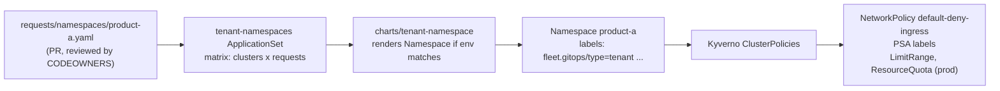

# 06 Tenants and guardrails

**Goal:** onboard a team with one reviewed YAML file, and let policy (not people) apply the safe defaults.
**Time:** 45 minutes

**You'll touch:** [requests/namespaces/](../requests/namespaces/), [requests/namespaces/schema.json](../requests/namespaces/schema.json), [charts/tenant-namespace/](../charts/tenant-namespace/), [applicationsets/tenant-namespaces-appset.yaml](../applicationsets/tenant-namespaces-appset.yaml), [addons/kyverno-policies/](../addons/kyverno-policies/), [.github/CODEOWNERS](../.github/CODEOWNERS), [.github/pull_request_template.md](../.github/pull_request_template.md), [docs/tenant-namespace-flow.md](../docs/tenant-namespace-flow.md)

## Concepts

A tenant here is a team that gets namespaces on the fleet. The flow:



Why split it like this:

- **The request** says *what the team wants* (name, environments, owner, Pod Security level). Small, readable, schema-validated.
- **The chart** turns a request into a labeled Namespace, and renders nothing for clusters not listed in `env` (that's why the ApplicationSet has `allowEmpty: true`).
- **Kyverno** reacts to the labels and creates the guardrails. Teams can't forget them, and the platform team can change them in one place for everyone.

| Label on the Namespace | Kyverno policy | Result |
| --- | --- | --- |
| `fleet.gitops/type: tenant` | `tenant-default-network-policy` | `NetworkPolicy/default-deny-ingress` |
| `fleet.gitops/policy-pod-security: restricted` | `tenant-pod-security-profile` | `pod-security.kubernetes.io/enforce: restricted` (+ audit, warn) |
| `fleet.gitops/type: tenant` (dev overlay) | `tenant-dev-limit-range` | `LimitRange/tenant-defaults` |
| `fleet.gitops/environment: prod` | `tenant-prod-resource-quota`, `tenant-prod-limit-range` | `ResourceQuota/tenant-resource-quota`, `LimitRange/tenant-defaults` |

The generate rules use `synchronize: true`: delete a generated NetworkPolicy and Kyverno puts it back.

**Review is the control.** [CODEOWNERS](../.github/CODEOWNERS) requires platform review for `requests/namespaces/`, and the PR template makes the author confirm they understand namespace deletion. Turn on branch protection with "require review from Code Owners" so that it's enforced and not just suggested.

## Hands-on

### 1. Look at an existing tenant

```bash
cat requests/namespaces/product-a.yaml
kubectl --context kind-prod get ns product-a --show-labels
kubectl --context kind-prod -n product-a get networkpolicy,limitrange,resourcequota
```

### 2. Render the chart yourself

```bash
helm template t charts/tenant-namespace \
  --set cluster.environment=prod \
  --set namespace.name=product-b \
  --set 'namespace.env={dev,prod}' \
  --set namespace.policies.podSecurity=restricted
helm template t charts/tenant-namespace --set cluster.environment=prod --set 'namespace.env={dev}'
```

The second one renders nothing: `product-a` only for dev means no namespace on prod.

### 3. Onboard a new team by PR

```bash
git switch -c onboard-product-b
cat > requests/namespaces/product-b.yaml <<'EOF'
namespace:
  name: product-b
  env:
    - dev
  owner: team-b
  requestedBy: team-b
  labels:
    - product-group-b
  policies:
    podSecurity: baseline
  purpose: team b sandbox
EOF
```

Validate against the schema before you push (any JSON Schema validator works; here with Python):

```bash
pip install --quiet check-jsonschema
check-jsonschema --schemafile requests/namespaces/schema.json requests/namespaces/product-b.yaml
```

```text
ok -- validation done
```

Push, open a PR, fill in the template, merge. Then:

```bash
argocd app get fleet-platform-config --refresh >/dev/null
kubectl --context kind-platform -n argocd get applications | grep product-b
```

### 4. Promote to prod

Add `- prod` to `env`, PR, merge. Prod gets the namespace plus a ResourceQuota that dev doesn't have.

## Check yourself

```bash
kubectl --context kind-dev get ns product-b -o jsonpath='{.metadata.labels.pod-security\.kubernetes\.io/enforce}{"\n"}'
```

```text
baseline
```

```bash
kubectl --context kind-prod -n product-b get resourcequota
```

```text
NAME                    AGE   REQUEST                                     LIMIT
tenant-resource-quota   1m    configmaps: 1/20, pods: 0/20, ...           limits.cpu: 0/4, limits.memory: 0/8Gi
```

## Break it on purpose

**1. Delete a guardrail.**

```bash
kubectl --context kind-dev -n product-b delete networkpolicy default-deny-ingress
kubectl --context kind-dev -n product-b get networkpolicy -w
```

Kyverno regenerates it (`synchronize: true`).

**2. Try to run a root pod in a restricted namespace.**

```bash
kubectl --context kind-prod -n product-a run root --image=busybox --restart=Never -- sleep 3600
```

Pod Security admission rejects it with a list of `restricted` violations. No custom webhook needed; the label did it.

**3. Delete a namespace request in a branch, and read the diff.** This is the scariest change in the repo, so practice reading it:

```bash
git switch -c remove-product-a
git rm requests/namespaces/product-a.yaml
git diff main --stat
```

Now think through what merging means: the matrix stops emitting `dev-tenant-product-a` and `prod-tenant-product-a`; those Applications have `resources-finalizer.argocd.argoproj.io`, so Argo CD deletes their resources, which is the Namespace, which deletes **everything inside it**. Same if you remove `prod` from `env`. That's what the PR template's "Namespace Safety" boxes are for. Don't merge; `git switch main && git branch -D remove-product-a`.

## Field notes

- In the workshop, nobody believed point 3 until they saw a namespace terminating. If your teams' data lives in those namespaces, consider dropping the finalizer for prod tenants, or adding `argocd.argoproj.io/sync-options: Prune=false` on the Namespace, and handle removal as a runbook step.
- Keep the request format small. Every field you add is a field you have to support forever. Quotas belong to the platform (policy), not the request, until a team genuinely needs a different size.
- Validate requests in CI with the schema (module 11). A typo in `env` (`prd`) otherwise silently means "nowhere".

## Quiz

1. Why does the tenant ApplicationSet set `allowEmpty: true`?
2. Who creates the `default-deny-ingress` NetworkPolicy, and what happens if someone deletes it?
3. What actually happens if you remove `prod` from a request's `env`?

<details>
<summary>Answers</summary>

1. The chart renders nothing for clusters not in `env`. Without `allowEmpty`, automated sync refuses to sync an app to zero resources.
2. Kyverno, via a generate rule matching namespaces labeled `fleet.gitops/type: tenant`. With `synchronize: true` it recreates it.
3. The prod app renders no Namespace, so with prune the prod Namespace and everything in it is deleted.

</details>

**Next:** [07 Observability](07-observability.md)
